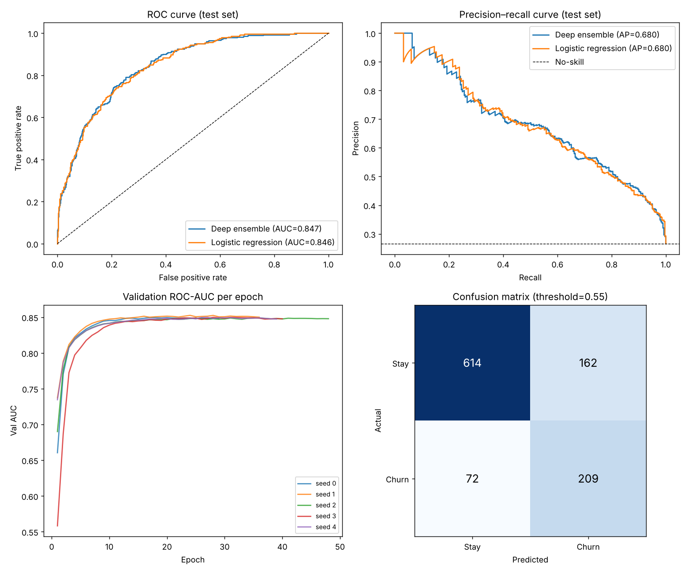

# Customer Churn Prediction with Deep Learning

Predicting which telecom customers will cancel their service, using a PyTorch deep learning model trained on the real **IBM Telco Customer Churn** dataset (7,043 customers, 26.5% churn).



## Results (held-out test set, 1,057 customers)

| Model | ROC-AUC | PR-AUC | F1 | Recall | Precision | Accuracy |
|---|---|---|---|---|---|---|
| **Deep ensemble (ChurnNet ×5)** | **0.847** | **0.680** | **0.641** | **0.744** | **0.563** | **0.779** |
| Logistic regression baseline | 0.846 | 0.680 | 0.632 | 0.733 | 0.555 | 0.773 |

At the chosen threshold (0.55, tuned on validation for F1) the model catches **74% of customers who churn** (209 of 281), while flagging 162 loyal customers as at-risk.

**Honest takeaway:** the deep model edges out a well-tuned logistic regression but only slightly. This dataset is small and its churn signal is largely linear (contract type, tenure, payment method), so a strong linear baseline is hard to beat. Always benchmark deep learning against a simple model on tabular data.

## Model

`ChurnNet` (see [`src/model.py`](src/model.py)) is a tabular deep learning architecture:

- **Entity embeddings** for each of the 15 categorical features (contract, internet service, payment method, …), learned jointly with the network
- **Continuous features** (tenure, charges, engineered features) standardized and batch-normalized
- **Residual MLP**: projection to 64 dims → 2 residual blocks (BatchNorm → SiLU → Dropout → Linear) → sigmoid output
- **Class imbalance** handled with `pos_weight` in BCE loss
- **Training**: AdamW, OneCycle LR schedule, gradient clipping, early stopping on validation ROC-AUC
- **Deep ensemble** of 5 seeds; predictions averaged

### Engineered features
- `AvgMonthlySpend` = TotalCharges / tenure
- `ChargeDelta` = current MonthlyCharges − historical average (detects recent price increases)
- `NumServices` = count of add-on services subscribed
- `LogTenure`

## Methodology

- Stratified **70 / 15 / 15** train / validation / test split (seed 42)
- Preprocessing fit on training data only (no leakage)
- Hyperparameters and decision threshold selected on **validation only**; test set used once for final reporting
- 11 brand-new customers with blank `TotalCharges` set to 0

## Project structure

```
├── data/telco_churn.csv        # IBM Telco Customer Churn dataset
├── src/
│   ├── data.py                 # loading, feature engineering, preprocessing, splits
│   ├── model.py                # ChurnNet architecture
│   └── train.py                # training, ensembling, baseline, evaluation, plots
├── results/
│   ├── metrics.json            # all test metrics
│   ├── evaluation.png          # ROC, PR, training curves, confusion matrix
│   └── churnnet_ensemble.pt    # trained model weights
└── requirements.txt
```

## Run it

```bash
pip install -r requirements.txt
python src/train.py --data data/telco_churn.csv --out results
```

Trains in under a minute on CPU. Options: `--seeds`, `--epochs`, `--hidden`, `--blocks`, `--dropout`, `--lr`, `--wd`, `--batch`.

## Data source

IBM Telco Customer Churn sample dataset — [IBM/telco-customer-churn-on-icp4d](https://github.com/IBM/telco-customer-churn-on-icp4d) (Apache-2.0).
